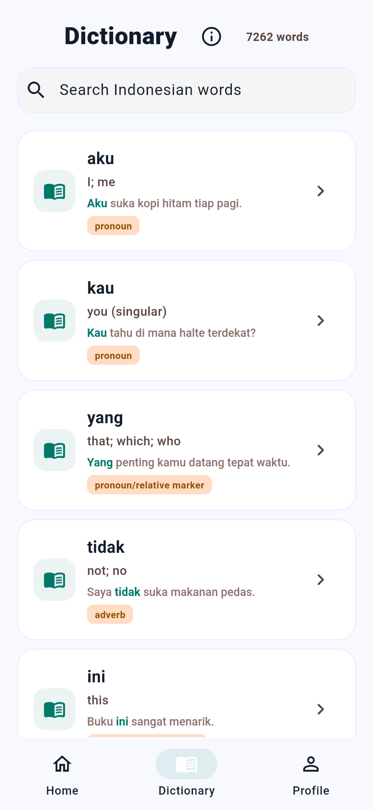

# IndoFreq

IndoFreq is an Indonesian vocabulary learning app with flashcards, quizzes, spaced repetition and a searchable dictionary.

**Indo** stands for Indonesian; **Freq** refers to the frequency-based vocabulary dataset. New words follow its frequency order. A lower rank means more common within that data, not easier.

[Open the web app](https://indofreq.web.app/) · [Website and Android downloads](https://mfarhancode.github.io/indofreq-site/) · [App repository](https://github.com/mfarhancode/indofreq)

## Features

- Flashcards with meanings, pronunciation and usage examples.
- Vocabulary quizzes and spaced repetition.
- Dictionary search, Saved Words and Known Words.
- Daily goals, local progress and JSON export/import.
- Offline learning after the web app's first online setup; pronunciation depends on the available device/browser voice.

Android installation uses an APK. Use the website's download section when a public release is available.

## In the app

Detailed learning records stay primarily on your device. Accounts use Firebase Authentication; Firestore stores aggregate progress summaries, not full backups. [Privacy policy](https://mfarhancode.github.io/indofreq-site/privacy.html).

A project by the **IndoFreq team**.
